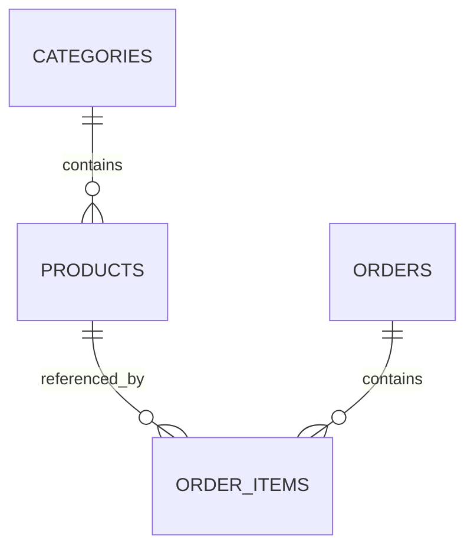

# Лабораторна 3 — схема бази даних (блок 1)

Автор: Пастушенко Ростислав, ІС-44.

Схема створена у першому блоці. У другому підключено Spring Data JPA та
сервісні транзакції. Актуальна інструкція запуску — [JPA.md](JPA.md).

## Структура та 3NF



| Таблиця | Призначення | Ключі та зв'язки |
| --- | --- | --- |
| `categories` | Назва категорії | PK `id`, UNIQUE `name` |
| `products` | Поточний каталог, ціна та залишок | PK `id`, FK `category_id`, UNIQUE `(category_id, name)` |
| `orders` | Замовлення та момент створення | PK `id` |
| `order_items` | Окремі позиції замовлення | PK `id`, FK `order_id`, FK `product_id` |

Кожна таблиця описує один тип фактів, поля атомарні. Неключові поля залежать
від ключа відповідного рядка. Назва категорії не дублюється у товарах:
її зміна не потребує оновлення всіх товарів. Категорію можна створити до
першого товару, і видалення останнього товару не видаляє категорію.

`order_items.product_name` та `unit_price` — історичні значення на момент
покупки, а не копії поточних полів каталогу. Той самий товар може мати різні
історичні ціни в різних замовленнях, тому `product_id` не визначає ці значення.
Підсумок рядка обчислюється як `unit_price * quantity`; загальна сума — сума
рядків. Збережених підсумків, які можуть розійтися з позиціями, немає.

Видалення замовлення видаляє його позиції (`CASCADE`). Видалення категорії
з товарами або товару, на який посилається замовлення, заборонене (`RESTRICT`).
OrderService вимагає 1–100 позицій і зберігає замовлення атомарно.
Списання складського залишку не входить у реалізований CRUD; деталі в JPA.md.

## Міграції

Liquibase 4.33.0 застосовує `src/main/resources/db/changelog/db.changelog-master.xml`.

1. `001-create-schema`: чотири таблиці, окремі ID sequences з кроком 1,
   зовнішні ключі та CHECK-обмеження.
2. `002-add-constraints-and-indexes`: унікальна назва категорії, унікальна
   назва товару в межах категорії, індекси для пошуку та зовнішніх ключів.
3. `003-seed-catalog`: три категорії та три товари з попередньої лабораторної.

Унікальність назв є чутливою до регістру. Індекс `(category_id, name)` вже
обслуговує запити за `category_id`; зайвий індекс цього самого префікса не
створюється. Звичайний B-tree `products.name` корисний для рівності й сортування;
він не гарантує прискорення пошуку з довільним `LIKE '%text%'`.

Ціни мають тип `NUMERIC(12, 2)` і допустимий діапазон поточної доменної моделі.
Перевірка зайвих десяткових знаків лишається також у Java/API: PostgreSQL
може округлити значення під час приведення до `NUMERIC(12, 2)`.

ID у початкових даних генеруються sequences. Категорія для товару знаходиться
за унікальною назвою. Це не залишає sequence позаду вставлених вручну ID.

`logicalFilePath` фіксує ідентичність changelog для CLI і майбутнього запуску
зі Spring. Після застосування міграції не редагуйте її: додавайте новий
changeSet. Liquibase перевіряє checksum та веде `databasechangelog`.

## Запуск локальної бази

Потрібний запущений Docker Desktop. Команди виконуються з папки, де лежать
`build.gradle`, `gradlew` і `compose.yaml`.

```bash
docker version
docker compose config --quiet
docker compose up -d --wait postgres
docker compose run --rm migrate validate
docker compose run --rm migrate
```

Після першого `update` очікуються 3 виконані changeSet. Повторний запуск:

```bash
docker compose run --rm migrate
```

має повідомити, що база актуальна, з 0 нових і 3 раніше виконаними changeSet.
Дані не повинні дублюватися. Сервіс `migrate` має профіль `tools`:
звичайний `up` його не запускає, а явний `run migrate` запускає.

Перевірка таблиць та початкових даних:

```bash
docker compose exec postgres psql -U cosmo -d cosmo_cats -c '\dt'
docker compose exec postgres psql -U cosmo -d cosmo_cats -c '\ds'
docker compose exec postgres psql -U cosmo -d cosmo_cats -c "SELECT id, name, category_id, price, stock_quantity FROM products ORDER BY id;"
docker compose exec postgres psql -U cosmo -d cosmo_cats -c "SELECT id, author, exectype FROM databasechangelog ORDER BY orderexecuted;"
```

Параметри для IntelliJ Database, якщо цей інструмент доступний, або іншого SQL-клієнта:

| Параметр | Значення |
| --- | --- |
| Host | `localhost` |
| Port | `15432` |
| Database | `cosmo_cats` |
| User | `cosmo` |
| Password | `cosmo_local` |
| JDBC URL | `jdbc:postgresql://localhost:15432/cosmo_cats` |

Це відкриті навчальні облікові дані для локальної бази. Порт опубліковано
лише на `127.0.0.1`. Якщо `15432` зайнятий, виконайте `export DB_PORT=15433`
у цьому терміналі перед командами Docker і використовуйте новий порт у клієнті.
Усередині Compose сервіс Liquibase підключається до `postgres:5432`.

Зупинка збереженої бази:

```bash
docker compose down
```

Дані залишаються в named volume і використовуються після наступного запуску.
Не додавайте `-v`, якщо не хочете видалити всю локальну базу.

## Що ще потрібно для здачі лабораторної 3

- Інтеграційні CRUD-тести з частковим Spring-контекстом, PostgreSQL і Testcontainers.
- Успішний CI та не менше 80% покриття.
- Пояснення рішень коментарями до коду в PR.

Схема та JPA реалізовані. Тестовий блок лабораторної 3 ще потрібно завершити.

Джерела: [завдання лабораторної 3](https://grzik-production.notion.site/c2fbf3d0970a8389b3920140cd78361a),
[образ PostgreSQL](https://github.com/docker-library/docs/blob/master/postgres/README.md),
[образ Liquibase 4.x](https://github.com/liquibase/docker),
[Docker Desktop для Mac](https://docs.docker.com/desktop/setup/install/mac-install/).
